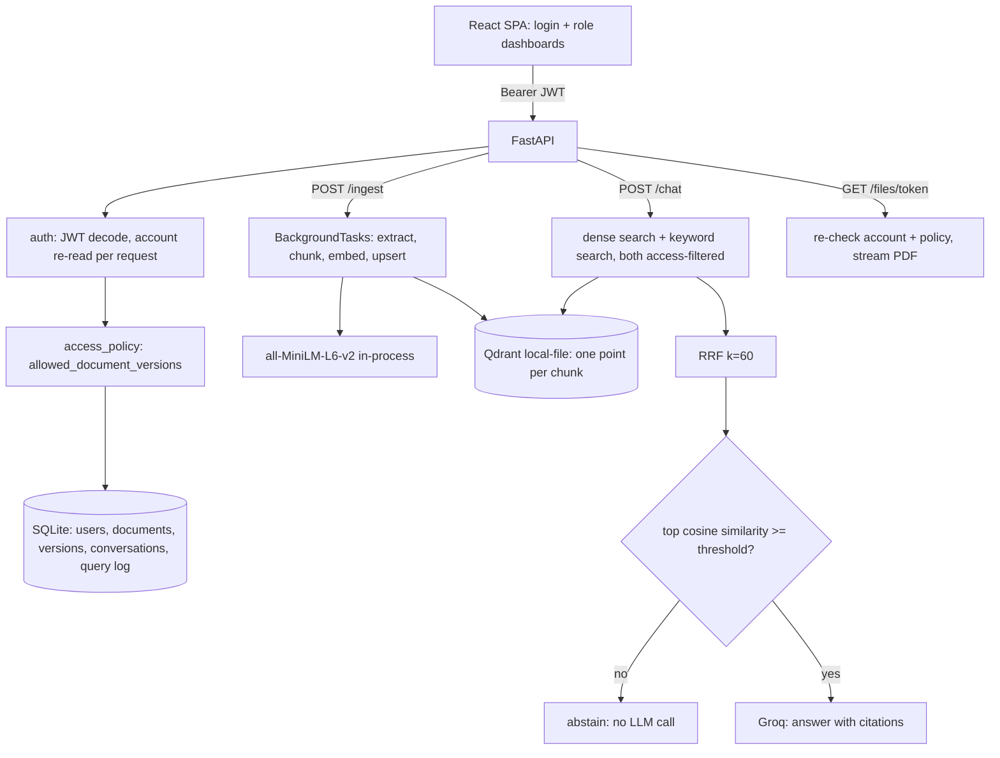
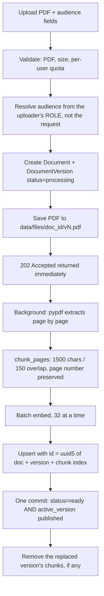

# Campus Synapse

A role-based college assistant built on retrieval-augmented generation. Students,
teachers and administrators ask questions in plain language and get answers drawn
**only from documents they are allowed to read**, with the source document and page
cited, and an explicit refusal when the documents cannot answer.

> **Screenshot needed** — the interface was rebuilt in Phase 6 (login page, three
> role dashboards, document sidebar, citation previews). Add a current screenshot
> here before submission.

---

## 📋 Table of Contents

* [Overview](#-overview)
* [Key Features](#-key-features)
* [Access Model](#-access-model)
* [System Architecture](#️-system-architecture)
* [Tech Stack](#️-tech-stack)
* [Folder Structure](#-folder-structure)
* [RAG Pipeline Deep Dive](#-rag-pipeline-deep-dive)
* [Security Model](#-security-model)
* [API Endpoints](#-api-endpoints)
* [Environment Variables](#-environment-variables)
* [Getting Started](#-getting-started)
* [Testing](#-testing)
* [Evaluation](#-evaluation)
* [Design Decisions & Trade-offs](#-design-decisions--trade-offs)
* [Known Limitations](#-known-limitations)

---

## 🌟 Overview

College information lives in PDFs — fee notices, syllabi, timetables, circulars,
regulations. Students cannot find answers quickly, and a general-purpose chatbot
is worse than useless here: it invents figures, cannot show where an answer came
from, and has no notion of who is allowed to see which document.

Campus Synapse addresses three problems at once.

**Exact terms get missed by pure vector search.** Course codes, fee heads and
figures are precisely the things students ask about, and dense embeddings
generalise them away. Retrieval is therefore hybrid — dense cosine similarity
alongside lexical matching — merged with Reciprocal Rank Fusion.

**Hallucination is unacceptable for fees and deadlines.** A wrong fee figure sends
a student to the accounts office with the wrong amount. Every answer cites its
document and page, and the system abstains rather than guess when the retrieved
evidence is too weak.

**Not every document is for everyone.** A fee notice belongs to one branch and
semester; a faculty circular is not for students. Permission is enforced on every
path by which content could escape — retrieval, citations, PDF previews, and
conversation history — not just on the search call.

---

## ✨ Key Features

* **Three roles with real separation.** Students, teachers and administrators get
  different dashboards, different upload rights and different search scopes.
* **Audience-scoped shared documents.** An admin publishes to everyone, to all
  students, to all teachers, or to a specific branch, semester and section. A
  teacher may publish only to a class in their own branch. Audience is always
  derived server-side from the uploader's role.
* **Personal uploads.** Any user can upload a private PDF that nobody else can
  read or retrieve.
* **Page-accurate citations.** Text is extracted page by page, so each chunk keeps
  its true page number. Answers carry `[N]` markers that open the source excerpt,
  and a "View page" button opens the original PDF at that page.
* **Abstention instead of invention.** If the top dense cosine similarity falls
  below a threshold, the endpoint returns a refusal and never calls the LLM.
* **Permission checks that survive change.** A preview link stops working the
  moment an account is deactivated or a document's audience changes, even while
  the token is still unexpired. Old answers whose sources became unreadable are
  dropped from both the display and any future model context.
* **Prompt-injection hardening.** Retrieved document text is delimited and
  labelled untrusted, so a PDF cannot issue instructions to the model.
* **Background indexing.** Uploads return immediately; indexing runs as a
  background task and the UI shows `Indexing → Ready` or `Failed` with the reason.
* **Admin console.** Create and deactivate accounts, and read the question log —
  including the questions the documents could not answer, which shows what
  information is missing or published to the wrong audience.
* **Local embeddings.** 384-dimensional vectors from `all-MiniLM-L6-v2` running
  in-process: no embedding API key, no rate limit, no document text leaving the
  machine for embedding.
* **Runs on one laptop.** Qdrant in local-file mode and SQLite mean the only
  external service is Groq.

---

## 🔐 Access Model

| Role | Can upload | Can publish to | Chat scope |
| :--- | :--- | :--- | :--- |
| **Student** | Personal PDFs | nothing | Shared documents whose audience matches them, plus their own uploads |
| **Teacher** | Personal PDFs | A class in their own branch | Shared documents whose audience matches them, plus their own uploads |
| **Admin** | Personal PDFs | Everyone, all students, all teachers, or any specific class | Shared documents, plus their own uploads |

Documents are either `personal` (readable only by the owner) or `shared` with one
of four audiences: `everyone`, `students`, `teachers`, or `class` (branch, with
optional semester and section).

A student's branch, semester and section come from their profile, which is what
makes *"what is the fee this semester"* answerable without the student having to
say which semester they are in.

---

## 🏗️ System Architecture

### Component relationships



**The design principle:** SQLite is the only source of truth for permissions.
Qdrant chunks carry a `doc_version` key and nothing about who may read them. At
query time the backend computes the set of document versions the caller may read
and passes it as a filter. An audience change or a deactivated account therefore
takes effect on the very next request, with no re-indexing.

### Ingestion flow



---

## 🛠️ Tech Stack

### Backend & API

| Technology | Purpose |
| :--- | :--- |
| **FastAPI** | ASGI framework, dependency-injected auth, automatic OpenAPI docs |
| **Uvicorn** | ASGI server, run with a single worker so the model loads once |
| **Pydantic v2** | Request and response validation, including college-ID and audience rules |
| **SQLAlchemy 2** | ORM over SQLite; switching to PostgreSQL is a connection-string change |
| **PyJWT** | Session tokens and separate short-lived preview tokens |
| **passlib + bcrypt** | Password hashing (see the version pin note in Limitations) |
| **pypdf** | Page-by-page text extraction |

### AI / retrieval

| Technology | Purpose |
| :--- | :--- |
| **Qdrant** (local-file mode) | Dense k-NN search and full-text matching in one engine, no server to run |
| **Sentence-Transformers** | `all-MiniLM-L6-v2`, 384-dimensional normalized vectors, in-process |
| **Groq** | Fast chat completions via an OpenAI-compatible endpoint, with retry and backoff |

### Frontend

| Technology | Purpose |
| :--- | :--- |
| **React 18 + Vite 6** | SPA with hot module replacement |
| **React Router 6** | Login route and one protected route per role |
| **Axios** | One client instance that attaches the Bearer token and handles 401 by signing out |
| **Vanilla CSS** | Design tokens with light and dark themes |

---

## 📁 Folder Structure

```
campus-synapse/
├── .env.example                  # Every environment variable, documented
├── requirements.txt              # Runtime and test dependencies
├── pytest.ini                    # Test discovery and path configuration
├── README.md                     # This file
├── data/                         # Runtime state, git-ignored
│   ├── campus.db                 #   SQLite database
│   ├── qdrant/                   #   Qdrant local-file store
│   └── files/<doc_id>/vN.pdf     #   Original PDFs
│
├── backend/
│   ├── main.py                   # App, router registration, stuck-ingestion cleanup
│   ├── config.py                 # Env parsing, institution constants, startup guard
│   ├── auth.py                   # JWT create/decode, get_current_user, require_role
│   ├── database.py               # Engine, SessionLocal, Base, get_db
│   ├── seed.py                   # Demo accounts for each role
│   ├── logger.py                 # Console + file logging
│   ├── models/
│   │   ├── db_models.py          # User, Document, DocumentVersion, Conversation, Message, QueryLog
│   │   └── schemas.py            # Pydantic request/response shapes
│   ├── routes/
│   │   ├── auth.py               # POST /auth/login, GET /auth/me
│   │   ├── ingest.py             # POST /ingest + background index_document()
│   │   ├── documents.py          # list, delete, replace, preview-link
│   │   ├── files.py              # GET /files/{token} with full re-authorisation
│   │   ├── chat.py               # The RAG endpoint
│   │   ├── conversations.py      # Owner-only history with source re-validation
│   │   └── admin.py              # Account management + question log
│   ├── services/
│   │   ├── access_policy.py      # allowed_document_versions() — the single gatekeeper
│   │   ├── qdrant_service.py     # Client, schema, dense + keyword search, deletion
│   │   ├── search_service.py     # Runs both branches inside the caller's scope
│   │   ├── embedding_service.py  # Model singleton
│   │   ├── fusion_service.py     # Reciprocal Rank Fusion
│   │   ├── llm_service.py        # Groq client with backoff
│   │   └── text_processor.py     # Page-aware extraction and chunking
│   └── utils/
│       └── query_utils.py        # Heuristic pronoun resolution
│
├── frontend/src/
│   ├── main.jsx                  # Entry point, wrapped in BrowserRouter
│   ├── App.jsx                   # Routes, theme, profile load
│   ├── api/client.js             # Axios instance: Bearer token, 401 handling
│   ├── hooks/useDocuments.js     # Document list, re-polls while indexing
│   ├── components/               # ProtectedRoute, DashboardShell, DocumentSidebar,
│   │                             # UploadModal, ChatPanel, CitationsAccordion
│   └── pages/                    # LoginPage, Student/Teacher/AdminDashboard
│
├── tests/                        # 106 pytest tests, no network or API key needed
├── eval/
│   ├── run_eval.py               # Retrieval and end-to-end evaluation
│   └── questions.jsonl           # Question set with gold documents and pages
└── scripts/
    └── make_demo_pdfs.py         # Synthetic college documents + audience plan
```

---

## 🔬 RAG Pipeline Deep Dive

### 1. Ingestion

* **Page-by-page extraction.** `pypdf` reads each page separately so every chunk
  records the page it came from. This is what makes a cited page trustworthy. A
  PDF with no text layer fails with a clear reason rather than indexing nothing.
* **Chunking.** Each page is split on paragraph boundaries, then sentence
  boundaries, into chunks of about 1500 characters with 150 characters of overlap.
* **Batch embedding.** Chunks are vectorised 32 at a time, in-process.
* **Deterministic point IDs.** `uuid5(NAMESPACE_DNS, "{document_id}_v{version}_{chunk_index}")`.
  Re-indexing a version overwrites its own points instead of duplicating them, and
  two users uploading the same filename never collide.
* **Atomic publication.** `status = "ready"` and `active_version` are written in a
  single commit, so no reader ever sees an active version whose chunks are not yet
  searchable. Only then are a replaced version's chunks removed.

### 2. Hybrid retrieval

* **Dense search.** The query is embedded and matched by cosine similarity.
* **Lexical search.** Qdrant's `MatchText` requires *every* token of the supplied
  text to be present in a chunk, so passing a whole question matches nothing. The
  query is therefore reduced to content words (stopwords and tokens of two
  characters or fewer removed) and each term becomes its own `should` clause, so
  any term can match. Hits are then ranked by **how many** query terms each chunk
  contains, because `scroll` returns rows in arbitrary order and a flat score
  would make the branch's fusion rank meaningless.
* **Both branches carry the same access filter.** Neither is a back door.
* **Reciprocal Rank Fusion** merges the two rankings:

  $$RRF(d) = \sum_{m \in M} \frac{1}{60 + r_m(d)}$$

### 3. Evidence check

The decision to answer is made on the **top dense cosine similarity**, compared
against `SIMILARITY_THRESHOLD`, not on the fusion score.

An RRF score depends only on rank, so a single first-ranked result always scores
`1/61 ≈ 0.0164` however poor the match. Any threshold below that — and both
earlier defaults were — lets every query through that returns even one hit. Cosine
similarity is bounded in `[0, 1]` and reflects actual closeness, so it can
separate strong evidence from weak.

Both numbers are returned as `top_similarity` and `top_fusion_score`, and the RRF
value is never called "confidence".

### 4. Generation

Up to `MAX_CONTEXT_DOCS` fused chunks, capped at 8000 characters, are passed as
numbered `[Source N]` blocks inside `<context>` delimiters, labelled as untrusted
reference material. Citation numbers in the reply are resolved back against the
chunks that were actually retrieved, so a citation cannot point at something that
was never used.

---

## 🛡️ Security Model

| Threat | Mitigation |
| :--- | :--- |
| Retrieval leak | Both search branches are filtered by the caller's allowed `doc_version` set. An empty set short-circuits before any Qdrant call. |
| Identity spoofing | Identity comes from a signed JWT. There is no client-supplied user header. |
| Stale privileges | The token carries only a user ID; role and active flag are re-read from the database on every request, so deactivation applies immediately. |
| Preview link reuse | The token is bound to user, document and version, expires in five minutes, and `GET /files/{token}` re-checks the account and the current policy on every request. |
| Preview token misuse | A separate `aud` claim means it cannot authenticate an API call. |
| History leak | Stored citations hold references only, never snippet text. An earlier answer whose sources became unreadable is dropped from the display and from future model context, along with the question that produced it. |
| Prompt injection | Retrieved text is delimited and labelled untrusted. |
| Insecure deployment | The server refuses to start if `JWT_SECRET` is missing or a known placeholder. |
| Brute-force login | Per-IP rate limiting with a generic failure message. |
| Upload abuse | PDF-only, size limit, per-user document quota, sanitised display names, generated storage paths. |

All of the above are covered by tests in `tests/`.

---

## 📡 API Endpoints

Every route except login requires `Authorization: Bearer <token>`.

| Method | Endpoint | Role | Description |
| :--- | :--- | :--- | :--- |
| `POST` | `/auth/login` | — | `{college_id, password}` → `{access_token}` |
| `GET` | `/auth/me` | any | Current profile: role, branch, semester, section |
| `POST` | `/ingest` | any | Multipart PDF + optional `audience_type`, `audience_branch`, `audience_semester`, `audience_section`. Returns `202` with `{document_id, version, status: "processing"}` |
| `GET` | `/documents` | any | Documents the caller may read, plus their own at any status |
| `DELETE` | `/documents/{id}` | owner | Marks deleted, then purges chunks and the stored PDF |
| `POST` | `/documents/{id}/replace` | owner | New version; active version switches only after indexing succeeds |
| `POST` | `/documents/{id}/preview-link` | allowed | `?page=N` → `{token, page_fragment}`, valid five minutes |
| `GET` | `/files/{token}` | token | Streams the PDF after re-checking account and policy |
| `POST` | `/chat` | any | `{messages, top_k, conversation_id?, document_ids?}` → reply, abstained, citations, both scores, conversation ID |
| `GET` | `/conversations` | owner | The caller's conversations |
| `GET` | `/conversations/{id}` | owner | History with unreadable sources masked |
| `POST` | `/admin/users` | admin | Create an account |
| `PATCH` | `/admin/users/{id}` | admin | Activate, deactivate or update |
| `GET` | `/admin/users` | admin | List accounts |
| `GET` | `/admin/questions` | admin | Question log; `?answered=false` for unanswered |

Interactive docs: `http://127.0.0.1:8000/docs`

---

## 🔑 Environment Variables

Copy `.env.example` to `.env`. Only `GROQ_API_KEY` and `JWT_SECRET` must be set by
hand; everything else has a working default.

| Variable | Description | Default |
| :--- | :--- | :--- |
| `JWT_SECRET` | **Required.** Signing key. The server refuses to start without a real one. Generate with `python -c "import secrets; print(secrets.token_hex(32))"` | — |
| `JWT_EXPIRE_MINUTES` | Session token lifetime | `60` |
| `GROQ_API_KEY` | **Required.** Groq API key | — |
| `GROQ_MODEL` | Model identifier | `openai/gpt-oss-120b` |
| `QDRANT_URL` | Leave blank for local-file mode; set for a remote server | *(blank)* |
| `QDRANT_API_KEY` | Only for a remote Qdrant | *(blank)* |
| `QDRANT_PATH` | Local-file store location | `./data/qdrant` |
| `INDEX_NAME` | Collection name | `campus_synapse` |
| `DATABASE_URL` | SQLAlchemy URL | `sqlite:///./data/campus.db` |
| `SIMILARITY_THRESHOLD` | Minimum top cosine similarity to answer | `0.35` |
| `MAX_CONTEXT_DOCS` | Fused chunks considered for the prompt | `20` |
| `CHAT_HISTORY_WINDOW` | Prior turns sent as context | `6` |
| `INGEST_BATCH_SIZE` | Chunks per embedding batch | `32` |
| `MAX_FILE_SIZE_MB` | Upload size limit | `5` |
| `MAX_FILES_PER_USER` | Documents per account | `10` |
| `FILE_STORAGE_PATH` | Where original PDFs are stored | `./data/files` |
| `ALLOWED_ORIGINS` | Comma-separated CORS origins | `localhost:5173` |

Institution constants — college email domain, the branch list, semesters and
sections — are set in `backend/config.py`.

The frontend reads only `VITE_API_URL` (optional, in `frontend/.env`). **Never put
a secret in a `VITE_*` variable:** they are compiled into the browser bundle.

---

## 🚀 Getting Started

### Prerequisites

* Python 3.10+
* Node.js 18+ and npm
* A Groq API key — the only external service

### Backend

```powershell
python -m venv .venv
.venv\Scripts\activate          # Windows
# source .venv/bin/activate     # macOS / Linux

pip install -r requirements.txt
```

Create `.env` from `.env.example` and set `GROQ_API_KEY` and `JWT_SECRET`, then
create the demo accounts and start the server:

```powershell
python -m backend.seed
uvicorn backend.main:app --workers 1
```

Tables and the Qdrant collection are created on first start. Use a single worker
so the embedding model loads once and only one process holds the local Qdrant
store.

**Demo accounts** created by `seed.py`:

| College ID | Password | Role |
| :--- | :--- | :--- |
| `admin@bitmesra.ac.in` | `admin123` | admin |
| `teacher.cse@bitmesra.ac.in` | `teacher123` | teacher (CSE) |
| `student.cse5a@bitmesra.ac.in` | `student123` | student (CSE, sem 5, sec A) |
| `student.ece3b@bitmesra.ac.in` | `student123` | student (ECE, sem 3, sec B) |

### Demo documents

Eight synthetic college documents, with the audience plan applied:

```powershell
python -m scripts.make_demo_pdfs --out data/demo_pdfs --upload
```

They are invented, so they are safe to show and safe to send to Groq. The first
upload is slow — the embedding model downloads once, about 90 MB.

### Frontend

```powershell
cd frontend
npm install
npm run dev
```

Open [http://localhost:5173](http://localhost:5173).

---

## 🧪 Testing

```powershell
python -m pytest
```

106 tests, roughly 70 seconds. **No network, no model download and no Groq key are
needed:** the suite stubs the embedding model with a deterministic bag-of-words
vector and stubs the LLM call, so everything else runs as the real code path.

| File | Covers |
| :--- | :--- |
| `test_auth.py` | login, generic 401s, rate limiting, forged and expired tokens, immediate deactivation |
| `test_access_policy.py` | each audience type, active-version-only, soft delete, audience change without re-indexing |
| `test_ingest.py` | audience rules per role, size/type/quota limits, image-only PDFs, deterministic IDs, same-filename isolation |
| `test_search_isolation.py` | empty scope makes no query, exact and paraphrased leaks blocked, conversation ownership, history filtering |
| `test_keyword_search.py` | stopword stripping, whole-question `MatchText` failure, OR-over-terms, term-overlap ranking |
| `test_chat_evidence.py` | abstention, the RRF ceiling, citation pages, persistence, query log, prompt hardening |
| `test_preview_tokens.py` | minting rules, cross-user refusal, expiry, death on deactivation or audience change |
| `test_text_processing.py` | per-page extraction, page-accurate chunking, RRF rank-not-score behaviour |

---

## 📊 Evaluation

Separate measurements, never one blended "accuracy" — they answer different
questions and fail for different reasons.

```powershell
# Compares dense / keyword / hybrid retrieval. Needs the real model; no server, no Groq key.
python -m eval.run_eval retrieval --questions eval/questions.jsonl --split dev

# End to end: citation page accuracy, abstention, latency. Needs a running server.
python -m eval.run_eval answers --questions eval/questions.jsonl --split dev
```

| Metric | Measured on |
| :--- | :--- |
| Retrieval hit rate@k | answerable questions |
| Citation page accuracy | answered questions |
| Correct abstention rate | unsupported questions |
| False abstention rate | answerable questions |
| Latency (median, p90) | all |

Results are written to `eval/results_*.csv` and `.md`. Answer correctness is
marked by hand against `gold_answer_points`.

`eval/questions.jsonl` carries a `dev` split for all tuning and a `test` split
that is frozen and run **once** for the final report, with the commit hash
recorded. At small sample sizes, quote counts as well as percentages.

---

## 📐 Design Decisions & Trade-offs

* **One permission function, used everywhere.** `allowed_document_versions()` is
  the only place access rules live. No route builds its own filter, which is why
  retrieval, citations, previews and history cannot drift apart.
* **Permissions in SQLite, not in the vector payload.** Copying audience data into
  Qdrant would mean re-indexing on every change and two sources of truth. The cost
  is one database query per chat request; the benefit is that a change applies on
  the next request.
* **Cosine similarity, not the fusion score, as the evidence signal.** RRF is
  ordinal by construction, so its scores cannot express match quality. See the
  pipeline section.
* **Qdrant in local-file mode.** No cluster to host or keep awake. The trade-off:
  payload indexes have no effect locally, so filtering is correct but unindexed —
  fine at demo scale. A remote server needs only `QDRANT_URL` changed.
* **Local embeddings.** No embedding API cost or rate limit, and document text
  never leaves the machine to be vectorised. Only the retrieved excerpts reach
  Groq, which is why demo documents should be synthetic or approved.
* **Background indexing with explicit status.** Uploads stay responsive and
  failures are visible rather than silent. Versions stuck in `processing` after a
  restart are marked failed on startup.
* **Heuristic pronoun resolution.** Resolving "it" and "this" from prior turns
  without an extra LLM round-trip keeps multi-turn latency and cost down.
* **SQLite over PostgreSQL.** One file, no server, trivial to reset for a demo.
  SQLAlchemy keeps the migration path open.

---

## ⚠️ Known Limitations

* **No OCR.** A scanned PDF with no text layer is rejected with a clear error.
* **No table understanding.** `pypdf` flattens tables into text, so fee tables and
  timetables may extract awkwardly.
* **`bcrypt` must stay below 4.1.** `passlib` 1.7.4 probes an attribute removed in
  4.1+ and then trips a 72-byte check, so password hashing fails outright. The pin
  is in `requirements.txt`; do not relax it without replacing `passlib`.
* **Login rate limiting is per IP and in memory.** Five attempts per minute. Raise
  `_MAX_ATTEMPTS` in `backend/routes/auth.py` before rehearsing several accounts
  from one machine, and note the counter resets when the server restarts.
* **Keyword search drops short tokens.** Tokens of two characters or fewer are
  stripped, which loses the `5` in "semester 5", `70` in "70%", and the branch name
  `AI`. The dense branch still carries those queries.
* **Keyword presence does not override abstention.** It is logged and returned as a
  secondary signal, but only similarity decides, pending calibration.
* **A failed upload has no retry button.** There is no endpoint to re-run indexing
  for an existing version; delete and re-upload instead.
* **Single institution.** Branches, semesters, sections and the email domain are
  constants in `backend/config.py`.
* **Evaluated on a small question set.** Treat the figures as indicative.
